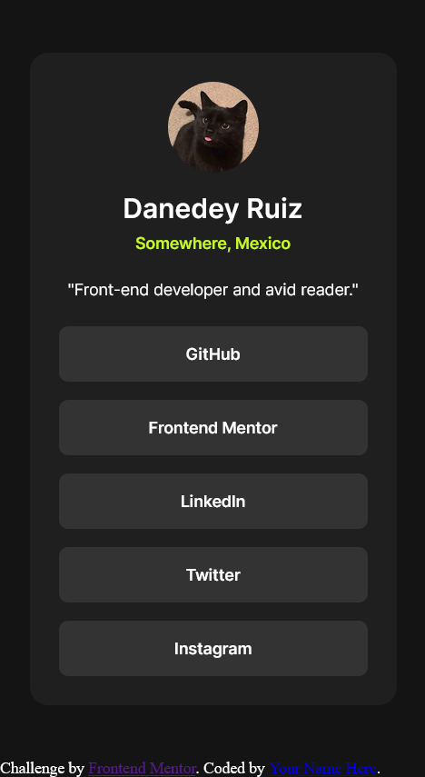

# Frontend Mentor - Social links profile solution

This is a solution to the [Social links profile challenge on Frontend Mentor](https://www.frontendmentor.io/challenges/social-links-profile-UG32l9m6dQ). Frontend Mentor challenges help you improve your coding skills by building realistic projects. 

## Table of contents

- [Overview](#overview)
  - [The challenge](#the-challenge)
  - [Screenshot](#screenshot)
  - [Links](#links)
- [My process](#my-process)
  - [Built with](#built-with)
  - [What I learned](#what-i-learned)
  - [Continued development](#continued-development)
  - [Useful resources](#useful-resources)
  - [AI Collaboration](#ai-collaboration)
- [Author](#author)

## Overview

### The challenge

Users should be able to:

- See hover and focus states for all interactive elements on the page

### Screenshot

### Links

- Solution URL: [Add solution URL here](https://your-solution-url.com)
- Live Site URL: [Add live site URL here](https://your-live-site-url.com)

## My process

### Built with

- Semantic HTML5 markup
- CSS custom properties
- Flexbox
- Mobile-first workflow

### What I learned

i learnt that you can define an h1 elemente inside somithing that's not a main or header element. This is the first proyect i use css variables to difine and use colors. And the first i use rem units instead of px, i'm still figuring out the difference between 1rem and 1px.

One thing a remenber is that time when i was defining some custom font inside @font-face i miswrite its format, from truetype to tff, for some reason the font worked but not quite, i asked copilot and it gave me the correction.

### Continued development
I need to figure out how inheritance of values work for some elements, like if a main element share the same width of its parent body element, and the same for an inner article.

### AI Collaboration

As always, i used copilot to understand why some things work the way they are, like "why do my fonts from @sym:@font-face when you set font-weight to 400 and 200 look the same?" or "is it a good practice putting a h1 inside a article? i mean, i know in this case is correct because that h1 is the main title for this exacly page, but didn't article means you can put this piece of information in another website? but thanks that there is a h1 inside, aren't you implying you can deliberately put a h1 inside another webside? and because of that your page can ended up with 2 h1 titles?"

## Author

- Frontend Mentor - [@Danedey](https://www.frontendmentor.io/profile/yourusername)
